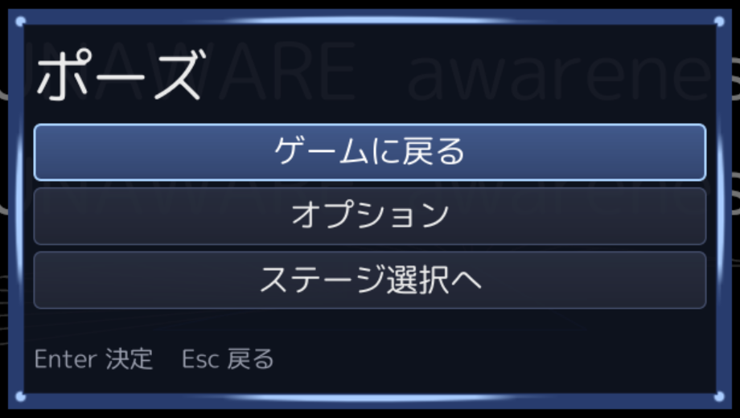
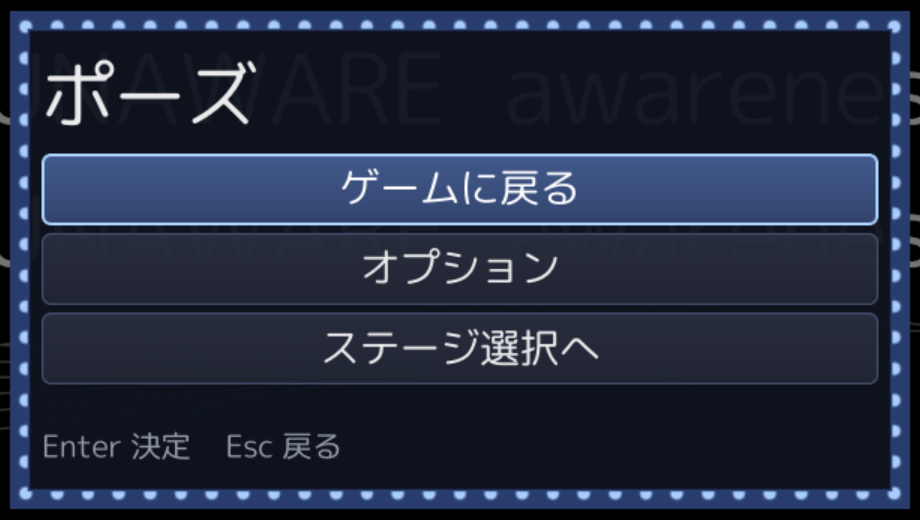

# UI の画像対応と、既存コードの問題と修正

作成：2026-11-10 04:17　更新：2026-11-10 04:42
対象ブランチ：`feature/ui-library`（UI ライブラリ本体のコミット 34a60774 の続き）

UI を画像で装飾できるようにした。その過程で、流用した既存コード（エンジンの Sprite・テクスチャ読み込み・シェーダー・シーンの重ね描き、および直前に作った UI ライブラリ自身）を読み直し、設計・実装の問題を直した。最初の実装はサブエージェントに厳しくレビューさせ、19 件の指摘のうち 15 件を直した（残りは 6 章）。

この文書は「何がまずかったか」と「どう直したか」の記録である。

---

## 1. 画像対応で何ができるようになったか

| 機能 | 場所 | 内容 |
|------|------|------|
| `Brush` | `core/ui/Brush.h/.cpp` | 面の塗り方。単色か画像。画像は 9 分割（辺・中央は引き伸ばし／並べる）・切り出し範囲・色の掛け合わせ・部分的な切り取りに対応。画像が読めないときは単色で代用 |
| テーマの面を `Brush` に | `core/ui/Theme.h` | 共通の面（`panel` / `row` / `row_focused` / `row_pressed` / `track` / `accent`）と用途別の面（`row_disabled` / `slider_fill` / `fill_disabled` / `slider_knob` / `toggle_on` / `tab_indicator` / `scroll_thumb` / `dialog_header`）。`Color` から暗黙変換できるので、既定値は従来どおり |
| テーマファイル | `core/ui/Theme.cpp`（`load_theme` / `load_theme_file`） | `panel.image = ui/panel.png` `panel.slice = 20` のように書いて見た目を差し替える。行番号付きでエラーを報告 |
| `Image` 部品 | `core/ui/Image.h/.cpp` | ロゴ・アイコン用。STRETCH（引き伸ばし）/ FIT（収める）/ FILL（覆う） |
| Renderer の画像描画 | `core/ui/Renderer.h`、`blue_sky/ui/Renderer.cpp` | `get_image_size` / `draw_image`（切り出し範囲付き）/ `get_pixel_scale` / `snap_to_pixels`。画像名は `media/texture/` からの相対パス |
| UI 用の画像読み込み | `Direct3D11::load_texture_premultiplied` | 乗算済みアルファ・ミップなし・常に UNORM |
| 乗算済みアルファの描画 | `sprite.hlsl` の `sprite_premultiplied` | ONE / INV_SRC_ALPHA で合成。ミップを使わないサンプラー |
| 先読み | `preload_theme_images` | UI のオーバーレイを開くときに、テーマの画像をまとめて読む |
| サンプル | `media/ui/sample_theme.txt`、`media/texture/ui/sample/*.png` | 設定 `ui.theme media/ui/sample_theme.txt` で有効になる |

設計の要点：

- 9 分割の分解・切り出し範囲の解決・切り取り・単色での代用は **core 側（D3D 非依存）** で行う。Renderer には、分解済みの「画像の一部を矩形に描く」だけを頼む。これで GPU なしにテストできる。
- 部品は従来どおり、テーマから見た目を読むだけ。画像にしたいときにコードを触る必要はない。
- 用途別の面が未指定、または画像が読めないときは、共通の面で代用する（`pick_brush`）。

---

## 2. 既存のエンジンコードの問題と修正

### 2.1 シーンの重ね描き：`Scene::is_transparent()` が使われていなかった（設計）

- **問題**：`Scene::is_transparent()` は「オーバーレイのとき、下のシーンを描くか」として宣言されている。しかし `GameMain::render()` はこれを見ずに、ベースシーンとすべてのオーバーレイを常に描いていた。フラグが飾りになっていた。
- **症状**：ポーズ画面の上にオプション画面を重ねると、下のポーズ画面が半透明のパネル越しに透けて見え、暗幕も二重にかかる。縁の明るい画像のパネルにすると特に目立つ。
- **修正**：
  - `GameMain::render()` で上から順に判断する。不透明なオーバーレイより下は、ベースシーンも含めて描かない。
  - 「下のオーバーレイだけを隠す」を表す `Scene::hides_overlays_below()` を追加した。UI のオーバーレイ（`UIOverlayScene`）は true を返す。メニューの上にメニューを重ねても下のメニューは見えず、ゲーム画面は見える。

### 2.2 テクスチャ：UI の画像にミップマップと異方性フィルタがかかっていた（実装・画質）

- **問題**：
  - `Direct3D11::load_texture()` は DirectXTK の WIC ローダーにデバイスコンテキストを渡している。そのため、ミップマップが自動で作られる。
  - スプライト用のサンプラー（`texture_sampler`）は異方性フィルタで、参照するミップの段（LOD）に上限がない。
- **症状**：1920x1080 以外の解像度（例：1280x720 では 2/3 倍）では、1 段粗いミップと混ざって角や細い枠線がぼける。1 枚の画像に複数の部品を詰めた場合（アトラス）は、ミップで隣の部品の色が混ざる。開発機の解像度でだけ綺麗に見える、気づきにくい不具合になる。
- **修正**：UI 用の読み込み `Direct3D11::load_texture_premultiplied()` を追加し、ミップを 1 段にした。描画には、ミップを使わない専用のサンプラー（`ui_texture_sampler`、`MaxLOD = 0`）を持つ technique `sprite_premultiplied` を使う。既存の 3D 用の読み込みは変えていない。

### 2.3 テクスチャ：ストレートアルファで縁がにじむ（実装・画質）

- **問題**：ブレンドが `SRC_ALPHA / INV_SRC_ALPHA`（ストレートアルファ）のまま、線形補間でサンプルしていた。
- **症状**：角丸や影のある PNG で、透明な画素の RGB（書き出したツールにより黒や白）が縁に混ざり、黒や白の縁取りが出る。等倍表示では出ず、拡大縮小したときだけ出る。
- **修正**：
  - UI 用の読み込みで、画素を RGB×A（乗算済みアルファ）に変換するようにした。
  - `sprite_premultiplied` は `ONE / INV_SRC_ALPHA` で合成する。
  - 掛け合わせる色はストレートで受け取り、シェーダーの中で乗算済みにする。

### 2.4 テクスチャ：PNG のメタデータで明るさが変わる（実装・画質）

- **問題**：WIC ローダーは、PNG に sRGB チャンクがあると `_SRGB` の形式でテクスチャを作る。一方、バックバッファは UNORM である。
- **症状**：sRGB チャンク付きの PNG（画像編集ソフトが付けることが多い）は、ガンマが二重に外れて暗く表示される。同じ見た目の素材でも、書き出したツールによって明るさが変わる。
- **修正**：UI 用の読み込みではメタデータを見ずに、常に `R8G8B8A8_UNORM` で作る。

### 2.5 ブレンド：UI がバックバッファのアルファを上書きしていた（実装）

- **問題**：既存のブレンド状態 `Blend` は、アルファの合成方法（`SrcBlendAlpha` / `DestBlendAlpha`）を指定していない。既定は ONE / ZERO なので、描いた画素の α がそのまま書き込まれる。
- **修正**：`PremultipliedBlend` では、アルファも `ONE / INV_SRC_ALPHA`（上に重ねる）で合成するようにした。既存の `Blend` は、3D 側への影響が読めないので変えていない（6 章）。

### 2.6 Sprite：切り出し範囲が整数ピクセルしか指定できない（設計）

- **問題**：`core::graphics::Sprite::draw()` の切り出し範囲は `win::Rect`（整数）だけだった。
- **症状**：`Image` の FILL（画像の中央を縦横比を保って切り取る）や、スライダーの充填を値の位置で切り取る処理では、切り出し範囲がピクセル未満の位置になる。整数に丸めると、画像がずれたり縦横比が崩れたりする。
- **修正**：UV（0〜1 の小数）で範囲を指定する `Sprite::draw_uv()` を追加した。アルファの扱い（`AlphaMode::STRAIGHT` / `PREMULTIPLIED`）も選べる。

### 2.7 Sprite：純粋仮想関数に既定引数が付いていた（設計）

- **問題**：最初の実装では `draw_uv` を、既定引数付きの純粋仮想関数として宣言していた。既定引数は呼び出し側の静的な型で決まるので、派生クラスの型から呼ぶと既定引数が使えない。
- **修正**：既存の `draw()` と同じ形にそろえた。protected の純粋仮想関数 `draw_uv_impl()` と、既定引数付きの public の非仮想関数 `draw_uv()` に分けた。

### 2.8 Sprite：テクスチャが null だと落ちる（実装）

- **問題**：`direct_3d_11::Sprite::draw()` は、`texture->get_width()` と `texture->bind_to_ps()` を無条件に呼んでいた。
- **修正**：null なら何もしないようにした（`draw()` と `draw_uv()` の両方）。

### 2.9 Sprite：頂点の書き込み処理が 2 か所に重複していた（実装）

- **問題**：`draw()` と `draw_color()` が、頂点バッファの Map・座標変換・描画命令をそれぞれ別に持っていた。片方だけ直すと食い違う。
- **修正**：
  - 共通の `draw_quad()`（描画先・UV・色・technique・テクスチャ）にまとめ、`draw()` / `draw_uv()` / `draw_color()` はそれを呼ぶだけにした。
  - 何の意味もない自己代入（`constant_buffer_data.transform = constant_buffer_data.transform;`）を消した。
  - 基底クラスの `draw_color()` を、空の既定実装から純粋仮想関数に変えた。実装を忘れると、何も描かずに黙って通ってしまうため。
  - 画面の高さが 0（最小化中など）のときは、座標が無限大になるので描かないようにした。

### 2.10 `sprite.hlsl`：コメントが文字化けしたまま保存されていた（実装）

- **問題**：コミット fae01b6f で UTF-8 に変換したとき、Shift_JIS のコメント 2 行が置換文字（U+FFFD）に化け、元の文字が失われていた。
- **修正**：履歴（c383fb2d）から元の文字「スプライト描画」「スプライト描画 ( 加算 )」を復元した。

### 2.11 テクスチャの読み込み失敗が例外で、呼び出し側の nullptr 判定が死んでいた（実装・要注意）

- **問題**：
  - `Direct3D11::load_texture()` は、失敗すると `common::exception<std::string>` を投げる。
  - 一方で `GraphicsManager::load_named_texture()` / `get_texture()` には「nullptr なら return」の分岐があるが、実際には通らない。
  - しかも `common::exception` は `std::exception` を継承していないので、`catch ( std::exception& )` では受け止められない。
- **対応**：
  - 既存の呼び出し元が例外を前提にしている可能性があるので、エンジン側の挙動は変えていない。代わりに、ヘッダーに「例外を投げ、nullptr は返らない」と明記した。
  - UI 側（`blue_sky::ui::Renderer::find_image()`）では、`common::exception` と `std::exception` の両方を受け止める。ログを出したうえで「読めない画像」として覚え、毎フレーム読み直さない。画面は単色の代用で描く。

---

## 3. 直前に作った UI ライブラリ（と最初の画像対応）の問題と修正

### 3.1 矩形の丸め：隣り合う矩形が 1 ピクセル重なる（実装）

- **問題**：`blue_sky::ui::Renderer::draw_rect()` は「左上は切り捨て・右下は切り上げ」で物理ピクセルに丸めていた。隙間はできないが、隣り合う矩形が 1 ピクセル重なる。
- **症状**：半透明の面を 9 分割で描くと、継ぎ目の線が二重に塗られて濃く見える。
- **修正**：`to_pixel_rect()` で、各辺を「辺の座標」から 1 つの式で物理ピクセルに写し、四捨五入する。辺を共有する矩形は同じピクセル位置で接する。幅が正なのに 0 ピクセルに丸まったときは 1 ピクセルにする（細い線が消えないように）。

### 3.2 9 分割：角の太さが位置によって 1px 変わる（実装）

- **問題**：最初の実装では、9 分割を仮想座標で分けてから、片ごとに独立して丸めていた。
- **症状**：2/3 倍などの半端な倍率では、角の物理幅が位置によって 10px / 11px と変わる。左右の角の太さもそろわず、スクロール中は角が伸び縮みしてちらつく。
- **修正**：
  - Renderer に `get_pixel_scale()`（仮想 1 あたりの物理ピクセル）と `snap_to_pixels()`（物理ピクセルにそろえた矩形）を追加した。
  - 9 分割では、外周をそろえてから枠幅を整数ピクセルにそろえ、辺は「外周 ± 枠幅」で出す。
  - テストで、倍率 2/3・位置と幅を 12 通りずらしても、継ぎ目が一致し角の太さが一定（11px）であることを確かめている。

### 3.3 共通の面 `accent` を形の違う 5 つの用途で兼用していた（設計）

- **問題**：`accent` 1 つを、5 つの用途で使っていた。
  - ダイアログ上端の帯（高さ 6）
  - タブの下線（高さ 6）
  - トグルの帯（幅 8）
  - スクロールバーのつまみ
  - スライダーの充填
- **症状**：
  - `accent` に枠幅 10 の 9 分割画像を指定すると、高さ 6 の帯では枠が潰れて歪む。
  - スライダーの充填は「形ごと縮める」方式だったので、値が小さいと両端の丸みが潰れる。
- **修正**：
  - 用途別の面 `slider_fill` / `tab_indicator` / `scroll_thumb` / `dialog_header` を追加した。未指定なら `accent` で代用する。
  - `draw_brush` に切り取り（clip）を追加した。スライダーの充填は「溝と同じ形で描き、値の位置で切り取る」にした（画像は元画像の範囲も同じ比率で切る）。

### 3.4 無効なボタンの見た目を指定できなかった（設計）

- **問題**：無効なボタンも、通常の `row` で描いていた。
- **修正**：`row_disabled` を追加した（未指定なら `row`）。

### 3.5 「画像の指定がある」と「実際に描ける」を区別していなかった（実装）

- **問題**：トグルのオン表示とスライダーのつまみは、`Brush::is_visible()`（画像名があれば true）で分岐していた。
- **症状**：画像のパスを間違えるなどで読めないと、オン表示もつまみも消える。代わりの「左端の帯」も出ないので、オンとオフの見分けが文字だけになる。
- **修正**：Renderer に実際に問い合わせる `can_draw()` を追加し、部品の分岐をこれに替えた。用途別の面の代用（`pick_brush`）も同じ判定を使う。

### 3.6 テーマファイルを文字列テーブルの読み込みで流用していた（設計・実装）

- **問題**：最初の実装では、テーマファイルを `StringTable`（表示文字列用）で読んでいた。そのため、次の問題があった。
  - 値の `\n` が改行に変わるので、`panel.image = ui\new.png` は黙って読めなくなる（単色で代用されるので気づきにくい）。
  - `nan` / `inf` を受け付けるので、`slice = nan` が負の値の検査をすり抜け、矩形が NaN になる。
  - 範囲の検査がない（`row_height = 0` や `label_ratio = 1.5` を受け付ける）。
  - 行番号がない。同じキーが 2 回あっても黙って後勝ちになる。エラーの順序も不定。
- **修正**：
  - テーマ専用のパーサにした（エスケープなし。`\` は `/` に直す）。
  - 数値は有限の値だけを受け付け、項目ごとに範囲を検査する。
  - エラーは「N 行目: キー: 理由」で報告し、重複キーは警告する。
  - 面の属性はキーの最後の `.` で分けるようにした（将来 `button.focused.image` のような階層の面名を足せるように）。

### 3.7 9 分割の辺と中央が引き伸ばししかできなかった（設計）

- **問題**：9 分割の四辺は辺の方向に、中央は両方向に、必ず引き伸ばしていた。
- **症状**：単色やグラデーションの枠なら問題ないが、模様のある枠（飾り・鎖・点線など）や柄のある中身は、パネルの大きさが変わると模様が間延びして崩れる（下の左）。
- **修正**：Brush に辺と中央の埋め方（`edge` / `center`）を追加した。テーマファイルでは `panel.edge = round` のように書く。
  - `stretch`：引き伸ばす（既定。従来どおり）
  - `repeat`：等倍で並べる。端数は両端で同じだけ欠ける（模様が中央にそろう）
  - `round`：並べる枚数を整数にし、1 枚をわずかに伸縮させてぴったり収める（模様が途中で切れない。装飾の枠向け）
  - 並べる 1 枚の大きさは、元画像の辺・中央の大きさに、角と同じ倍率を掛けたもの（模様の縦横比が角とそろう）。
  - 1 軸に 256 枚を超えるときは、描画命令が爆発しないよう引き伸ばしにする。

| `panel.edge = stretch`（従来） | `panel.edge = round`（追加） |
|---|---|
|  |  |

辺に 16px ごとに丸い飾りがある枠（`media/texture/ui/sample/panel_ornate.png`、`slice = 16`、`slice_scale = 2`）でポーズ画面を描いた比較。引き伸ばしでは飾りが細長い線に崩れ、`round` では丸のまま均等に並ぶ。

### 3.8 その他

- **画像名の正規化**：`ui/a.png` と `./ui/a.png`、`ui\a.png` を同じ画像として扱う（二重に読み込まない）。
- **先読み**：最初の描画やレイアウトの途中で同期的な読み込みが走って引っかからないよう、UI のオーバーレイを開くときにテーマの画像を読む。
- **ログの文字化け**：ソースは `/utf-8` なので、日本語のログは UTF-8 になる。それを `OutputDebugStringA`（ANSI として解釈）で出していたため、テーマのエラーが出力ウィンドウで化けていた。`blue_sky::debug_log()`（UTF-16 に変換して `OutputDebugStringW`）に替えた。
- **切り出し範囲が画像の外**：画像の中に収める。

### 3.9 再レビュー（修正後のコードの見直し）で見つかった問題

修正したコードを、別のサブエージェントにもう一度レビューさせた。修正で持ち込んだ問題も含め、12 件をすべて直した。

| 問題 | 修正 |
|------|------|
| Sprite の「画面の高さが 0 なら描かない」ガードを、頂点バッファを Map した**後**に置いていた。抜けると Unmap されず、次の Map で例外になる | 判定を Map の前に移した。`set_transform()` にも同じガードを入れた |
| オーバーレイの描画範囲の判断で、「下を隠すメニュー」の下に不透明なオーバーレイがあっても、ベースシーンを描いていた | 判断を純粋関数 `compute_overlay_render_range()`（`Scene/OverlayRenderRange.h`）に切り出し、テストを付けた。隠されたものも含め、不透明なオーバーレイがあればベースシーンは描かない |
| ベースシーンを描かないフレームでは、画面がクリアされない（クリアは各シーンの render の中にある） | GameMain がクリアする |
| 9 分割の外周は物理ピクセルにそろえていたが、切り取り範囲はそろえていなかった。半端な倍率では、端の角の画像が 1 画素未満だけ削られてずれる | 切り取り範囲もそろえる |
| テスト用の Mock の丸め方が、本物の Renderer と違っていた（原点のずれ・最低 1px がない）。継ぎ目のテストは同じ値どうしを比べていて、実質的に何も確かめていなかった | 丸め方を `core/ui/PixelSnap.h` の関数 1 つにまとめ、本物と Mock で共有した。テストは「物理ピクセルに写した矩形どうし」で、横と縦の継ぎ目と四隅の太さを、原点が端数のときも含めて確かめる |
| `Image` 部品は、切り出し範囲が画像の外にはみ出してもそのまま使っていた（Brush は画像の中に収めている） | Brush と同じく画像の中に収める |
| UI 用の読み込みで、WIC のファクトリーを毎回作っていた | 1 つを使い回す（終了時の順序の問題を避けるため、あえて解放しない） |
| 画像が大きすぎるときのエラーが「size : 0」になり、原因が分からなかった | 大きさと上限（8192）を書く |
| テーマファイルで `panel` と `panel.color`（同じ項目）が重複しても警告しなかった。`panel.` のような属性が空のキーを受け付けていた | 項目単位で重複を判定する。属性が空ならエラーにする |
| テーマファイルのパスに日本語があると開けなかった（`std::ifstream( const char* )` は ANSI として解釈する） | UTF-8 として `std::filesystem::path` で開く |
| 画像の読み込みで、`common::exception` と `std::exception` 以外の例外（`DIRECT_X_FAIL_CHECK` が投げる型など）が抜けていた | すべての例外を受け止め、単色で代用する |

**挙動が変わった点（記録）**：`Sprite::draw()` で描画先を省略したとき（画像を画面中央に原寸で描く）の位置は、元は浮動小数で計算していたため、0.5px の位置になることがあった。共通化した後は整数ピクセルに切り捨てる。見た目はむしろくっきりするが、元のコードと完全に同じではない。あわせて、元の計算は符号なし整数の引き算で、画像が画面より大きいと値が回り込んでいた。共通化した後はそれも起きない。

---

## 4. Unity・UE との比較

ここでの両エンジンの仕組みは、記憶している範囲の説明で、ドキュメントを見て確かめてはいない（要確認）。

| 機能 | Unity（uGUI） | UE（UMG / Slate） | blue-sky（今回） |
|------|--------------|-------------------|------------------|
| 見た目の単位 | `Image` 部品＋ Sprite（枠幅は Sprite Editor で設定） | `FSlateBrush`（枠幅は画像サイズに対する割合） | `Brush`（枠幅はピクセル。テーマファイルで設定） |
| 9 分割（四隅は固定） | Sliced | Box | slice |
| 辺・中央を並べる | Tiled | Image の Tiling（Box の辺は伸ばす。要確認） | edge / center = repeat / round |
| 中央を描かない | Fill Center をオフ | Border | center = none |
| 一部だけ塗る（ゲージ） | Filled（横・縦・円形） | マテリアルで作る | 横方向の切り取りのみ（スライダーの充填） |
| 画像なしの角丸 | なし（画像を使う） | Rounded Box（UE5） | なし |
| 状態ごとの見た目 | Selectable の Transition（色・画像の差し替え・アニメーション） | `FButtonStyle`（Normal / Hovered / Pressed / Disabled） | 共通の面（row / row_focused / row_pressed / row_disabled）。部品ごと・Hovered はなし |
| 描画命令のまとめ | Canvas 単位で自動 | Slate が要素をまとめる | なし（6 章） |
| 見ながら設定する道具 | エディタ | エディタ | なし（テキストファイル） |

---

## 5. 画像を作るときの注意

- **パス**：画像名は `media/texture/` からの相対パスで、区切りは `/`（`\` も受け付けるが `/` に直す）。
- **アトラス**：1 枚の画像に複数の部品を詰めるときは、部品の間を 1〜2px 空けるか、端の画素を外側に延ばしておく。ミップは使わないが、線形補間で隣の 1 画素は混ざるため。
- **透明部分**：乗算済みアルファに変換して読むので、透明な画素の RGB は気にしなくてよい。

---

## 6. 今回は直さなかったもの（後続の課題）

| 内容 | 理由・方針 |
|------|-----------|
| 描画命令のまとめ（バッチ化） | 1 枚ごとに Map と描画命令が走る。9 分割は 9 回になり、オプション画面で数百回になる。Sprite に頂点バッファの追記とテクスチャ切り替え時の flush を持たせる。性能を測ってから着手する |
| 画像名のハンドル化 | Renderer に毎回文字列を渡し、文字列のハッシュで引いている。バッチ化と合わせて ID で引くようにする |
| UI のテクスチャの寿命 | Renderer は GraphicsManager が持つテクスチャの生ポインタを覚えている。今は誰も解放しないので安全だが、将来 "ui:" で始まる名前を解放すると、解放済みのポインタを使ってしまう。画像のキャッシュを 1 か所にまとめ、世代番号付きのハンドルにする |
| はみ出す部品の描画 | ScrollView は「完全に収まる部品だけ描く」方式で、背の高い Image は表示されない。シザー矩形（push_clip / pop_clip）を導入する |
| 部品ごとのスタイル | 今は行・ボタン・タブが同じ面を共有している。`ButtonStyle { normal, focused, pressed, disabled, icon }` のような部品別のスタイルを足す（キーの解釈は対応済み） |
| 高解像度用の素材 | 4K では枠が 2 倍に引き伸ばされてぼける。倍率に応じて `name@2x.png` を選ぶ |
| 既存の `Blend` のアルファ合成 | 3D 側への影響が読めないので、UI 用の新しいブレンドだけを直した |
| UI の上に細い縦線が出る | enemy_ai_test の操作タブで、キー欄の上に縦の細い線が出る。画像のテーマを外しても出る（今回の変更より前からある）。不透明な欄の上に見えるので、シーン側の何かが UI の後に描かれている可能性がある。原因は未調査 |

---

## 7. テスト

`source/test/ui/UIImageTest.cpp`（GPU 不要。Mock の Renderer が draw_image を記録し、物理ピクセルの倍率を変えられる）。

- **draw_brush**：
  - 単色、何も描かない場合、画像全体、切り出し範囲、読めないときの代用、色が透明なとき
  - 9 分割の各片の位置と継ぎ目、枠幅の倍率、描画先が小さいとき、枠幅が画像より大きいとき
  - 半端な倍率での継ぎ目と角の太さ
  - 切り取り（画像・9 分割・単色）、切り出し範囲のはみ出し、アトラスの 9 分割
- **can_draw / pick_brush**：読めない画像、色での代用
- **Image**：FIT / FILL / STRETCH の配置、高さの決まり方、読めない画像、フォーカスを受けないこと
- **部品**：
  - テーマに画像を指定したボタン（9 分割）
  - スライダーのつまみと充填の切り取り
  - トグルのオン表示（読めないときの帯）
  - 無効なボタンの面の代用
- **テーマファイル**：
  - 面・色・寸法の読み込み、行末のコメント、画像の解除、`\` の扱い
  - 不正な行の行番号付きの報告
  - nan / inf / 範囲外の値、重複キー
  - 先読み

- **9 分割の辺・中央の埋め方**：round（整数枚・隙間なし）、repeat（等倍・両端の欠け）、中央の縦横の並べ、中央を描かない（none）、枚数が多すぎるときの引き伸ばし、テーマファイルの `edge` / `center`
- **再レビューの対応**：原点が端数のときの横・縦の継ぎ目と四隅の太さ、半端な倍率での切り取り、Image の切り出し範囲、重複・空の属性、日本語のパスのテーマファイル、オーバーレイの描画範囲（5 通り）

結果：全 190 件中 189 件が成功。失敗した 1 件 `NeuralNprTest.DmlInferenceSmoke` はモデルファイルがないためで、作業前から失敗している。

実機（enemy_ai_test 上で、サンプルテーマを指定）では、次を撮影で確かめた。

- ポーズ画面とオプション画面が画像で描かれること（乗算済みアルファの経路）
- スライダーの充填が角を保ったまま切り取られること
- オプション画面の下にポーズ画面が透けないこと
- ESC でポーズ画面に戻ること
